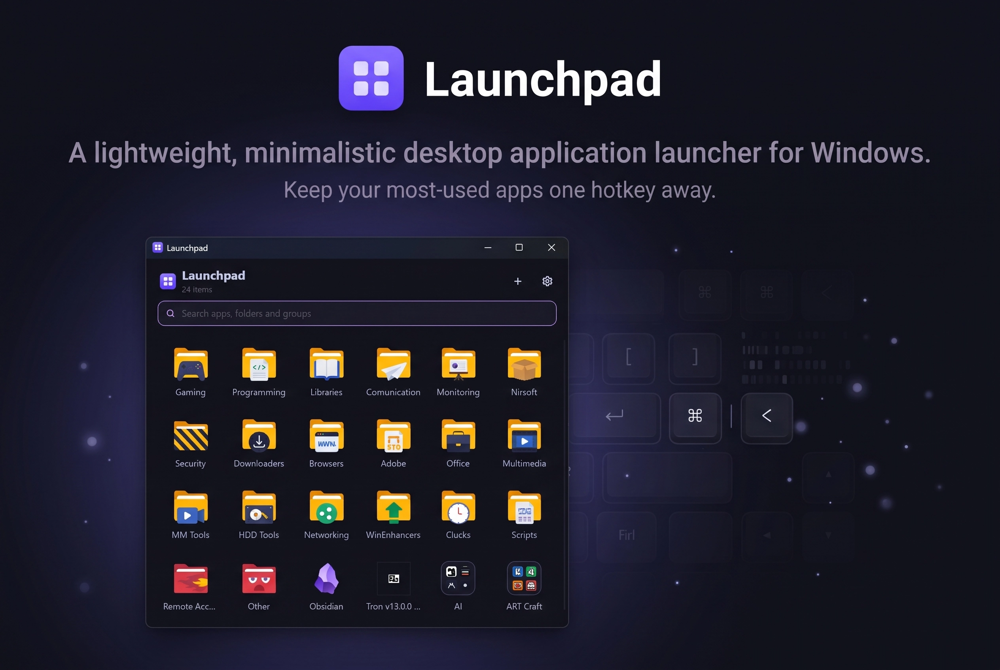

<div align="center">


# Launchpad

**Keep your most-used apps one hotkey away.**

A lightweight, minimalistic desktop application launcher for Windows. Press a shortcut, type a few letters, hit Enter. Organise apps, folders and shortcuts into groups, drag things in from Explorer, and get back to work.

[](LICENSE.md)




</div>

---

## Features

- **Global hotkey** — Configurable shortcut (default `Ctrl+Alt+R`) shows / hides the launcher; record it in Settings, applies instantly
- **Instant search** — Start typing to filter apps, folders and groups everywhere; arrows + Enter launch
- **Groups** — Organize items into groups (with a preview of their contents); drop a tile onto a group to move it in
- **Drag & drop** — Drop executables, shortcuts, files or folders from Explorer; drag tiles to reorder
- **Real icons** — Extracted from the Windows shell (shortcuts, legacy icons, folders), or pick your own
- **Item menu** — Right-click (or Shift+F10): open, show in Explorer, rename, change icon, move between groups, remove (with Undo)
- **Themes** — Dark, Light, Dracula, Nord, Catppuccin plus custom themes; adjustable icon size and spacing, or fit to window
- **System tray** — Close to tray, start with Windows, hide after launching, keep on top
- **Portable mode** — `config.json` next to the exe takes priority over `%APPDATA%`

## Installation

### From source

```bash
git clone https://github.com/X4Lo/LaunchPad.git
cd LaunchPad
cargo build --release
```

The binary will be at `target/release/launchpad.exe`.

### Portable mode

Place a `config.json` file in the same directory as `launchpad.exe`. Launchpad will automatically detect and use it, keeping all configuration self-contained alongside the executable — no files written to `%APPDATA%`.

## Configuration

Configuration is stored as JSON. The default location is `%APPDATA%\Launchpad\config.json`.

### Config structure

```json
{
  "items": [
    {
      "type": "app",
      "id": "...",
      "title": "Google Chrome",
      "executable_path": "C:\\Program Files\\Google\\Chrome\\Application\\chrome.exe",
      "icon_path": null
    },
    {
      "type": "group",
      "id": "...",
      "title": "Games",
      "icon_path": null,
      "items": [
        {
          "type": "app",
          "id": "...",
          "title": "Google Chrome",
          "executable_path": "C:\\Program Files\\Google\\Chrome\\Application\\chrome.exe",
          "icon_path": null
        }
      ]
    },
    {
      "type": "folder",
      "id": "...",
      "title": "Documents",
      "folder_path": "C:\\Users\\Me\\Documents",
      "icon_path": null
    }
  ],
  "window_x": 100,
  "window_y": 200,
  "window_width": 640,
  "window_height": 480,
  "grid_spacing": 12,
  "grid_icon_size": 48,
  "hide_on_launch": false,
  "hotkey": "Ctrl+Alt+R"
}
```

Window position and size are saved automatically whenever you move or resize the launcher.

### Hotkey

The global hotkey toggles Launchpad visibility (show/hide). It defaults to `Ctrl+Alt+R`.

You can change it in `config.json`:

```json
{
  "hotkey": "Ctrl+Shift+F"
}
```

Or record it in **Settings → General → Show / hide Launchpad**: click the chip and press the keys. Changes apply immediately.

**Supported modifiers:** `Ctrl`, `Alt`, `Shift`, `Win`/`Super`

**Supported keys:** `A`–`Z`, `0`–`9`, `F1`–`F12`, `Space`, `Tab`, `Esc`, `Enter`, `Backspace`, `Delete`, arrow keys (`Up`/`Down`/`Left`/`Right`), `Home`, `End`, `PageUp`/`PageDown`, `PrintScreen`, `ScrollLock`, `Pause`, `Insert`, `CapsLock`, `NumLock`, numpad keys (`Num0`–`Num9`, `NumAdd`, `NumSubtract`, `NumMultiply`, `NumDivide`, `NumDecimal`, `NumEnter`).

**Examples:**

- `Ctrl+Alt+R` (default)
- `Ctrl+Shift+F`
- `Win+Space`
- `Alt+F12`

### Themes

Launchpad supports themes for customizing colors, corner radius, and grid layout. See [docs/themes.md](docs/themes.md) for full documentation.

Quick example — add this to your `config.json`:

```json
{
  "themes": [
    {
      "name": "My Custom Theme",
      "header_color": "2E3440",
      "body_color": "242933",
      "widget_color": "3B4252",
      "selection_color": "5E81AC",
      "corner_radius": 10
    }
  ],
  "selected_theme": "My Custom Theme"
}
```

Built-in themes: **Dark** (default), **Light**, **Dracula**, **Nord**, **Catppuccin**.

## Keyboard & mouse

| Input              | Action                                   |
| ------------------ | ---------------------------------------- |
| `Ctrl + Alt + R`   | Show / hide Launchpad (configurable)     |
| Type               | Search everything                        |
| Arrow keys, Enter  | Move the selection, open it              |
| `Esc`              | Clear search → leave group → hide        |
| `Backspace`        | Leave a group (when the search is empty) |
| `F2` / `Del`       | Rename / remove the selected item        |
| `Shift + F10`      | Item menu for the selection              |
| `Ctrl + ,`         | Settings                                 |
| Mouse back/forward | Leave a group / go back into it          |

## Auto-start with Windows

Enable **Start with Windows** in Settings → General. Launchpad writes a registry value at:

```
HKEY_CURRENT_USER\Software\Microsoft\Windows\CurrentVersion\Run
    "Launchpad" = "\"C:\path\to\launchpad.exe\" --minimized"
```

It starts in the tray. When disabled, the value is removed. No admin rights required.

## Item types

| Type       | Icon                                               | Behavior                           |
| ---------- | -------------------------------------------------- | ---------------------------------- |
| **App**    | From the Windows shell (or custom)                 | Launches the application           |
| **Group**  | Preview of its first four items (or custom)        | Navigates into a sub-grid of items |
| **Folder** | The folder's shell icon (or custom)                | Opens the folder in Explorer       |

Items whose target no longer exists show a red **!** badge. Paths may use `$(Drive)` for the drive Launchpad runs from.

## Building

**Requirements:** Rust 1.82+

```bash
cargo build # or
cargo build --release
```

The release binary is optimized with LTO and stripped for minimal size.

## Documentation

- [Technical reference](docs/technical-reference.md) — threads, the app controller, the Slint UI and icon extraction
- [Themes](docs/themes.md) — built-in themes and how to write your own
- [Folder structure](docs/folder-structure.md) — where everything lives
- [Changelog](docs/changelog-recent.md)
- [Contributing](CONTRIBUTING.md)

## Credits

Developed by X4Lo with the help of AI coding assistants: the original version with Zed Agent and DeepSeek V4 Pro, and the 1.0 rework (Slint UI, icon extraction, theme editor) with **Claude Opus 5.5** (Anthropic), which wrote the code and documentation from X4Lo's specification. The UI design system is shared with [HushKey](https://github.com/X4Lo/HushKey).

## License

[MIT](LICENSE.md). The UI is built with [Slint](https://slint.dev), used under its Royalty-free Desktop license (attribution is shown in the app's About section).
